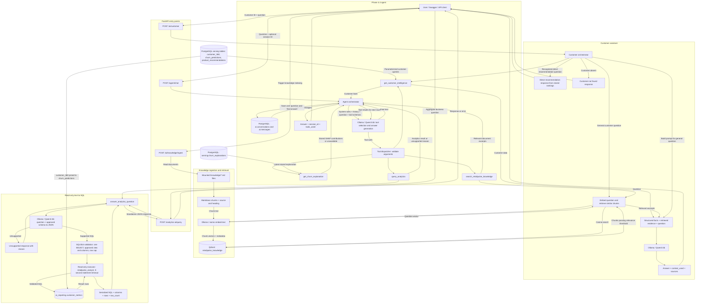

# RetailPulse AI — GenAI data flow

This diagram describes the current source implementation. Runtime validation of the analytics endpoint and its agent integration remains pending; the latest reported issue was reporting-view setup or permissions.

## Implementation details

- The agent allows four model rounds and up to three tool calls per round. Conversation memory stores user and assistant messages; the returned tool trace records tool names and arguments.
- Knowledge ingestion rebuilds the configured Qdrant collection. Retrieval filters cosine similarity scores below 0.3; the customer assistant requests four chunks, and the agent knowledge tool requests two.
- Customer lookup and SHAP tools use fixed parameterized SQL. Only the analytics tool generates SQL, which passes through SQLGlot validation before execution with the analyst database account.
- Analytics is limited to the approved customer reporting view and 100 rows. Product revenue by month is unsupported because the view lacks products and transaction dates.
- SHAP contributions, churn predictions, and product rankings are precomputed data read by these flows; the GenAI request does not train or run those underlying models.
- Ollama supplies both chat generation and embeddings using separate models. Defaults are `qwen3:4b` and `nomic-embed-text`.

## Source map

| Component | Source |
| --- | --- |
| API router registration | `api/app/main.py` |
| Customer assistant | `api/app/ai/orchestrator.py` |
| Customer database queries | `api/app/ai/tools.py` |
| Agent orchestration | `api/app/agent/orchestrator.py` |
| Agent tools | `api/app/agent/tools.py` |
| Conversation persistence | `api/app/agent/memory.py` |
| Knowledge ingestion and retrieval | `api/app/rag/` |
| Analytics generation, validation and execution | `api/app/text2sql/` |
| Approved reporting view | `sql/ai_reporting.sql` |
| Analyst role setup | `sql/create_analyst_role.sql` |
