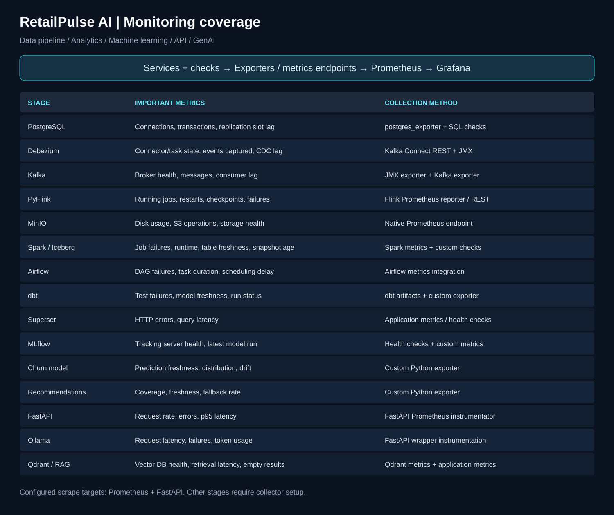

# RetailPulse AI monitoring

Monitoring coverage for the data pipeline, analytics, machine learning, API, and RAG services.



## Monitoring plan

This table describes intended coverage. Exporters and checks must be configured before their metrics appear in Prometheus.

| Stage | Important metrics | Collection method |
| --- | --- | --- |
| PostgreSQL | Connections, transactions, replication slot lag | postgres_exporter + SQL checks |
| Debezium | Connector/task state, events captured, CDC lag | Kafka Connect REST + JMX |
| Kafka | Broker health, messages, consumer lag | JMX exporter + Kafka exporter |
| PyFlink | Running jobs, restarts, checkpoints, failures | Flink Prometheus reporter / REST |
| MinIO | Disk usage, S3 operations, storage health | Native Prometheus endpoint |
| Spark / Iceberg | Job failures, runtime, table freshness, snapshot age | Spark metrics + custom checks |
| Airflow | DAG failures, task duration, scheduling delay | Airflow metrics integration |
| dbt | Test failures, model freshness, run status | dbt artifacts + custom exporter |
| Superset | HTTP errors, query latency | Application metrics / health checks |
| MLflow | Tracking server health, latest model run | Health checks + custom metrics |
| Churn model | Prediction freshness, distribution, drift | Custom Python exporter |
| Recommendations | Coverage, freshness, fallback rate | Custom Python exporter |
| FastAPI | Request rate, errors, p95 latency | FastAPI Prometheus instrumentator |
| Ollama | Request latency, failures, token usage | FastAPI wrapper instrumentation |
| Qdrant / RAG | Vector DB health, retrieval latency, empty results | Qdrant metrics + application metrics |

## Current configuration

- [Prometheus](prometheus/prometheus.yml) scrapes itself, PostgreSQL and Kafka exporters, FastAPI, MinIO, and Qdrant every 15 seconds. Rule evaluation is also set to 15 seconds. MinIO scraping uses a local bearer-token file; custom pipeline metrics are not configured because this Compose stack does not define a corresponding exporter.
- [Grafana datasource provisioning](grafana/provisioning/datasources/prometheus.yml) registers `http://prometheus:9090` as the default datasource.
- The root Compose file defines Prometheus and Grafana with persistent storage. The remaining stages above are not yet configured as scrape targets.

## Start and inspect

From the repository root, set `GRAFANA_ADMIN_PASSWORD` in your environment or root `.env`, then run:

```bash
docker compose --profile ingestion up -d prometheus grafana kafka-exporter
```

The ingestion profile starts Kafka and its exporter; the exporter waits until Kafka passes its health check. Other scrape targets are healthy only while their corresponding services are running.

### First pass: verify Kafka exporter

Keep the existing `apache/kafka:4.0.1` image and KRaft configuration. The first pass uses `kafka-exporter` against `kafka:9092`; it does not require a Java agent or a broker restart.

Validate Compose and start the exporter and Prometheus:

```bash
docker compose --profile ingestion config --quiet
docker compose --profile ingestion up -d kafka-exporter prometheus
docker compose --profile ingestion ps kafka kafka-exporter prometheus
docker compose --profile ingestion logs --tail 100 kafka-exporter
```

Check <http://localhost:9308/metrics> for `kafka_brokers 1` and topic metrics such as `kafka_topic_partition_current_offset` when topics exist. In Prometheus, verify `up{job="kafka"} == 1` and `kafka_brokers == 1`. Both checks matter: a reachable exporter alone does not prove it can collect broker metadata. Consumer lag metrics require consumer groups with committed offsets.

If collection fails, inspect the exporter logs and Kafka health first. The exporter must connect over the Compose network to `kafka:9092`, and Kafka must advertise that same internal address. Port `9094` is for host clients.

### Second pass: broker JMX metrics

Introduce JMX only after the exporter checks above pass. Build a small derived image from `apache/kafka:4.0.1`, keeping all existing KRaft settings. Include an actual compatible Prometheus JMX Java agent JAR at `/opt/monitoring/jmx_prometheus_javaagent.jar` and a Kafka metrics configuration at `/opt/monitoring/kafka-jmx.yml` inside the image before setting:

```yaml
KAFKA_OPTS: "-javaagent:/opt/monitoring/jmx_prometheus_javaagent.jar=7071:/opt/monitoring/kafka-jmx.yml"
```

Missing or unreadable agent files can prevent Kafka from starting. Pin and verify the agent artifact during the image build, then verify broker startup and the metrics endpoint from the Compose network. Once that works, add this job to `prometheus/prometheus.yml` and restart Prometheus:

```yaml
- job_name: kafka-jmx
  static_configs:
    - targets: ["kafka:7071"]
```

The JMX job is intentionally not active in the first pass. Kafka exporter supplies topic offsets and consumer lag; JMX adds broker and JVM metrics.

### Debezium JMX

The Debezium service builds [a derived image](debezium/Dockerfile) from the existing `quay.io/debezium/connect:3.3.2.Final`. It packages the actual JMX exporter 1.0.1 agent and [PostgreSQL connector rules](debezium/debezium-jmx.yml), verifies the JAR SHA-256 during the build, and loads it with `KAFKA_OPTS`. Connector JSON, internal topics, offsets, and CDC settings are unchanged. Applying the image briefly restarts Connect.

The vendored JAR comes from [Maven Central](https://repo.maven.apache.org/maven2/io/prometheus/jmx/jmx_prometheus_javaagent/1.0.1/jmx_prometheus_javaagent-1.0.1.jar). Its SHA-256 is `7d61f737fd661610ccc14aea79764faa1ea94a340cbc8f0029b3d2edea3d80c1`. JMX attribute names follow the [Debezium 3.3 PostgreSQL monitoring documentation](https://debezium.io/documentation/reference/3.3/connectors/postgresql.html#postgresql-monitoring).

After verifying Kafka exporter, build and apply Debezium monitoring:

```bash
docker compose --profile ingestion config --quiet
docker compose --profile ingestion up -d --build debezium
docker compose restart prometheus
docker compose logs --tail 100 debezium
curl http://localhost:8083/connectors/retailpulse-postgres-connector/status
```

Verify the connector and its tasks are `RUNNING`. In Prometheus, check `up{job="debezium-jmx"} == 1`, `jmx_scrape_error{job="debezium-jmx"} == 0`, `debezium_events_seen_total{context="streaming"}`, and `debezium_source_lag_seconds{context="streaming"}`. Connector metrics appear after the connector registers its MBeans; streaming metrics require streaming to start. A healthy scrape alone does not prove the connector is running.

The exporter listens on container port 7071, reachable by Prometheus at `debezium:7071`; no host port or remote JMX/RMI configuration is required. Source lag is converted from milliseconds to seconds and reflects the last processed event, not an independent freshness probe. Event counters reset when the connector restarts or metrics reset; use `rate(debezium_events_seen_total{context="streaming"}[5m])` for throughput.

### Pipeline status exporter

`retailpulse-metrics` collects Connect status, Flink job status, and PostgreSQL logical-slot retained WAL every 60 seconds. It uses `debezium:8083`, `flink-jobmanager:8081`, and `postgres:5432` on the existing `retailpulse` network. Its host endpoint is <http://127.0.0.1:9105/metrics>.

The root `.env` reuses the existing dedicated `metrics_reader` connection through `MONITORING_POSTGRES_DSN=${POSTGRES_EXPORTER_DSN}`. Ensure that account has monitoring privileges by running the grant script as the database administrator. From PowerShell or Git Bash:

```bash
docker compose cp monitoring/exporters/grant_monitoring.sql postgres:/tmp/grant_monitoring.sql
docker compose exec postgres sh -c 'psql -U "$POSTGRES_USER" -d "$POSTGRES_DB" -f /tmp/grant_monitoring.sql'
docker compose config --quiet
docker compose up -d --build retailpulse-metrics
docker compose logs --tail 100 retailpulse-metrics
```

Start ingestion and Flink services as needed for their collectors to succeed. Verify `retailpulse_collector_success{stage="postgres"}`, `retailpulse_collector_success{stage="debezium"}`, and `retailpulse_collector_success{stage="flink"}` at the metrics endpoint after the first collection. A running HTTP endpoint alone does not establish collector success.

### Spark execution and Iceberg freshness

Spark event logging is enabled in the existing Iceberg Spark defaults. `spark-iceberg` and `spark-thrift` share the persistent `spark_events` volume; `spark-history` reads it at <http://127.0.0.1:18080>. Catalog, warehouse, and S3A settings are preserved. Event logging is disabled only for dependency resolution during the image build. The History Server follows [Spark 4.0.1 monitoring configuration](https://spark.apache.org/docs/4.0.1/monitoring.html). Future driver/executor services must mount the same volume at `/opt/spark-events` when using these defaults. Event logs currently have no automatic retention policy.

Airflow's `retailpulse_iceberg_monitoring` DAG runs every 15 minutes after it is unpaused, using the existing Spark container. It queries snapshot commit times for `silver.customers`, `silver.orders`, `gold.customer_360`, `gold.order_summary`, and `gold.product_performance`. It also scans each table for the latest available configured timestamp. This can be expensive on large tables; adjust the schedule to fit the workload.

The metrics exporter reads atomic JSON results from the persistent `spark_monitoring` volume and computes ages on every scrape. Failed table checks omit age values and expose `retailpulse_iceberg_table_check_success=0`. Missing/empty timestamps omit ages rather than reporting a false zero. Monitor `time() - retailpulse_iceberg_check_timestamp_seconds` to detect a stopped schedule even if the last table check succeeded.

`retailpulse_table_data_age_seconds` includes a `timestamp_column` label: silver prefers `_ingested_at`, then Debezium `_ts_ms` (milliseconds); gold uses `_gold_processed_at` when present. Gold processing time measures materialization freshness, not the latest business event. Missing gold processing timestamps are reported as unavailable; do not interpret snapshot age as event freshness. Review these column choices for your live schemas.

The shared Airflow Iceberg submission helper now publishes `retailpulse_spark_job_duration_seconds`, `retailpulse_spark_job_success`, start/completion timestamps, and running status through `retailpulse-metrics`. Job labels use script stems (for example `build_silver_current_state`). Other submission helpers are not instrumented. For manual monitored submissions use:

```bash
docker compose exec spark-iceberg python3 /opt/retailpulse/monitoring/exporters/run_spark_job.py /opt/retailpulse/lakehouse/iceberg/jobs/check_freshness.py
```

Execution metrics describe the latest invocation per script, not a historical counter. A killed wrapper can leave running status set; use start time and Airflow task state to investigate long-running jobs. Completed executions are also available in the History Server.

Build/apply when no Spark jobs are running; recreating `spark-thrift` interrupts dbt sessions:

```bash
docker compose --profile etl up -d --build --no-deps spark-iceberg spark-thrift spark-history retailpulse-metrics
docker compose restart prometheus
```

Unpause `retailpulse_iceberg_monitoring` in Airflow, or run the manual check above. Verify `up{job="retailpulse-metrics"}`, per-table check status, snapshot/data ages, and check timestamps in Prometheus. Metrics require an actual completed check and existing tables; merely starting the exporter does not create freshness readings.

### Configure authenticated MinIO metrics

MinIO metrics remain authenticated. Create a dedicated MinIO access key with only the `admin:Prometheus` permission, then generate its bearer token with `mc admin prometheus generate <alias> --api-version v3`. Save only the token value (not the surrounding YAML) to `monitoring/prometheus/secrets/minio_token`; this local secret is excluded from Git. Do not use the MinIO root key as the Prometheus token.

Restart Prometheus after creating or rotating the token:

```bash
docker compose restart prometheus
```

- Prometheus: <http://localhost:9090> — inspect target health for scrape failures.
- Grafana: <http://localhost:3000> — sign in with `GRAFANA_ADMIN_USER` (default `admin`) and the configured password. Use the provisioned Prometheus datasource.

## Extend coverage

1. Enable each native metrics endpoint or deploy the collector listed above. REST, SQL, health checks, and artifact checks need a collector exposing Prometheus-format metrics.
2. Add the collector service name, port, metrics path, and any required authentication to `prometheus/prometheus.yml`.
3. Reload or restart Prometheus and verify the new target before building Grafana panels.
4. Add alert rules and notification routing for failures, lag, latency, freshness, and drift, using thresholds appropriate to the workload.

Track collection health separately from pipeline health: a healthy scrape does not guarantee fresh data or successful jobs. Calculate API p95 latency from histogram metrics, and measure CDC, consumer, prediction, model, and table freshness explicitly.

## Files

- `README.md`: monitoring plan and setup notes.
- `monitoring-overview.svg`: scalable picture of all 15 stages.
- `prometheus/prometheus.yml`: scrape configuration.
- `grafana/provisioning/datasources/prometheus.yml`: default datasource.
